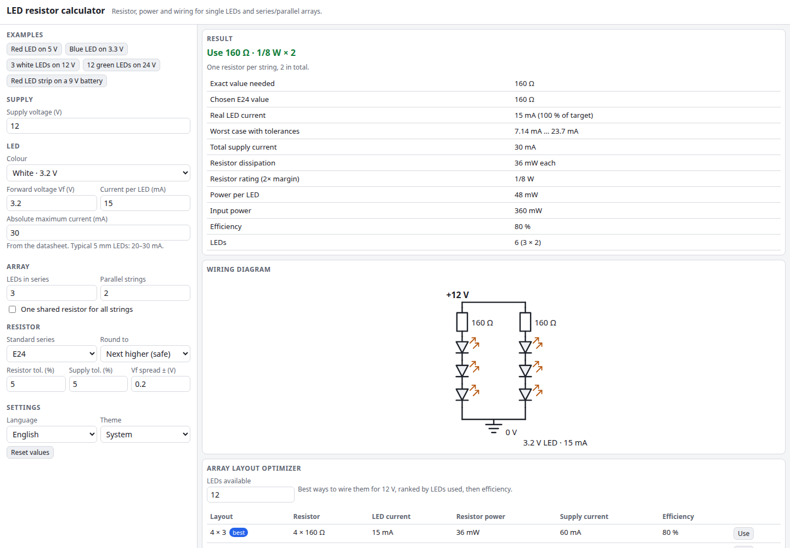

# LED Resistor Calculator

Which resistor does your LED need? Enter the supply voltage, the LED colour and the current you want. You get the exact series resistor, the nearest standard E-series value, the real current it gives, the resistor's power dissipation and rating, and the efficiency. It handles single LEDs and series/parallel arrays, ranks the best way to wire the LEDs you have, and draws the wiring diagram.

**Try it: [hermes98761234.github.io/led-resistor-calculator](https://hermes98761234.github.io/led-resistor-calculator/)**

[](https://github.com/hermes98761234/led-resistor-calculator/actions/workflows/deploy.yml)



## Features

- **Single LEDs and arrays.** Any number of LEDs in series, any number of parallel strings, with one resistor per string or (with a warning) one shared resistor.
- **LED colour presets** with typical forward voltages (infrared to UV), or enter your own Vf, current and maximum current.
- **Standard parts.** Round to the next higher (safe), nearest or next lower value in E6, E12, E24, E48 or E96, and see the real current and brightness of the neighbouring values.
- **Power and efficiency.** Resistor dissipation, a recommended wattage with a 2x margin, power per LED, total input power and efficiency.
- **Worst case.** The current range once resistor tolerance, supply tolerance and Vf spread are applied, with warnings for overdrive and for too little headroom.
- **Array layout optimizer.** Give it the number of LEDs you have. It lists every workable strings-by-series layout for your supply, ranked by LEDs used and then efficiency, and applies one with a click.
- **Wiring diagram** (SVG) that follows your array.
- **English and Ukrainian, light/dark/system theme.** Settings and inputs are kept in the browser. Nothing is sent anywhere.

## How it works

For a string of n LEDs on supply Vs, the resistor must drop Vs - n * Vf at the target current, so R = (Vs - n * Vf) / I. The result is rounded to a standard value and the real current is recomputed from that value. Resistor power is I² * R, and efficiency is LED power divided by input power, which is n * Vf / Vs for equal currents. With a shared resistor it carries the sum of the string currents.

E6, E12 and E24 use the tabulated IEC 60063 values. E48 and E96 follow the rounded 10^(i/N) rule, which reproduces the standard tables. Forward voltages are typical figures at 20 mA, so check your LED's datasheet. Results are estimates.

## Quick start

You need [Node.js](https://nodejs.org/) 22.

```bash
git clone https://github.com/hermes98761234/led-resistor-calculator.git
cd led-resistor-calculator
npm install
npm run dev       # http://localhost:5173
npm test          # calculation, state and i18n tests
npm run build     # static site in dist/
```

## License

MIT
